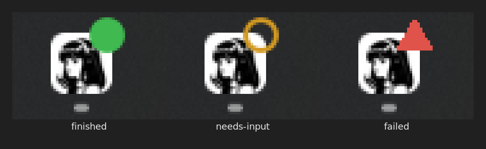
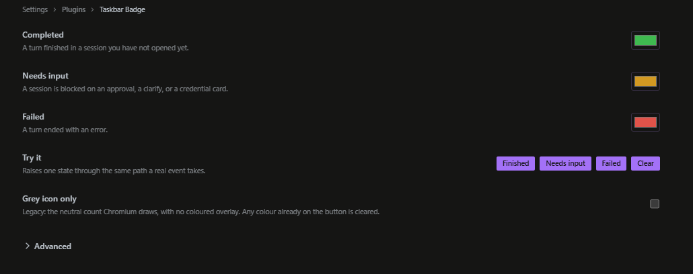

# hermes-taskbar-badge

> [!WARNING]
> Windows is the only platform where colour is tested end to end. It draws on the app's window with a call Microsoft does not document for other processes, so a Windows or Electron update can break it.
>
> Linux gets the dot and the grey count. Colour there needs a dock that honours LauncherEntry (Ubuntu Dock and Dash-to-Dock do, plain GNOME does not), and I have not run it against a live dock.
>
> The colour half runs on the machine that runs Hermes, which is the app's machine in a normal install. When the two are on different boxes, read Known limits.

A turn ends while you are in another app and nothing tells you. This puts a small dot on the Hermes taskbar button so you can see it from across the screen.

| Dot | Means |
|---|---|
| green disc | a turn finished |
| amber ring | a session is waiting on you: approval, clarify, password prompt |
| red triangle | a turn failed |

The dot clears when you open that session. Other sessions keep theirs. Failure outranks waiting, waiting outranks finished.

When no bridge can draw the coloured dot, the grey count Chromium puts on the button is the fallback, and the status-bar dot still shows the state.

The two halves talk to each other over loopback on the same machine. Nothing leaves it, and there is no other network call.

## Install

Capabilities -> Plugins -> Install from Git, then `BrokeSkill/hermes-taskbar-badge`. Nothing else. The plugin has two halves and they arrive together: the desktop half draws the dot and holds the settings, the Python half colours the Windows button.

## Settings

Settings -> Plugins -> Taskbar Badge. Pick the three colours, or press a test button to raise the dot without waiting for a real turn. Advanced folds out under a click and gives one event type its own colour.

Grey icon only puts the plugin back to the legacy look: Chromium's neutral count on the button, no colour. The switch clears a colour that is already up, and turning it off brings the colour back.

Nothing is installed outside the plugin folder and no login item is created. Delete the plugin and the coloured badge is gone.

## Known limits

Gateway and app on separate machines. The Python half runs inside Hermes, so it paints the taskbar of whichever box runs the gateway. If your gateway is a Pi and your app is a laptop, the plugin cannot colour the laptop button on its own: a desktop plugin has no way to start a process, and it cannot write a file outside its own storage, so it cannot install or launch the bridge for you. What the laptop shows until you act is the grey count and the status-bar dot.

The fix is one command on the laptop. Copy `bridge.py` from this repo there and run `python bridge.py`, once per login, or add it to that machine's startup. The plugin then finds it on `127.0.0.1:8766` and colours the button as usual. Every other install, where Hermes and the app share a machine, needs none of this.

A prompt raised by a session you are not looking at may not light up. Opening that chat does.

## License

MIT.
