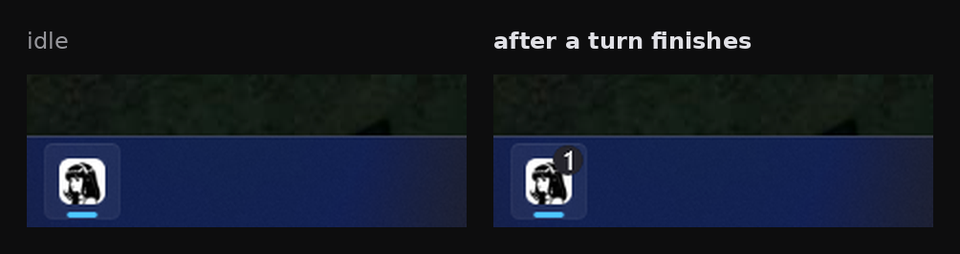

# hermes-taskbar-badge

[](LICENSE)


A Hermes Desktop plugin that puts a badge on the Hermes taskbar button when a turn finishes.



## Install

Hermes Desktop loads desktop plugins from its own `desktop-plugins` folder. Open Capabilities -> Plugins and use Install from Git with `BrokeSkill/hermes-taskbar-badge`.

To place the file yourself:

```bash
git clone https://github.com/BrokeSkill/hermes-taskbar-badge.git /tmp/hermes-taskbar-badge
mkdir -p ~/.hermes/desktop-plugins/hermes-taskbar-badge
cp /tmp/hermes-taskbar-badge/desktop/plugin.js ~/.hermes/desktop-plugins/hermes-taskbar-badge/plugin.js
```

On Windows the folder is `%LOCALAPPDATA%\hermes\desktop-plugins\`. The app hot-reloads desktop plugins on save, so there is no restart.

## Usage

A finished turn raises the badge while the window is in the background. Returning to the window, or opening another session, clears it.

## Requirements

- Windows. The badge renders on the taskbar there.
- Hermes Desktop with the `message.complete` event and `host.state.focusedStoredSessionId` in the plugin SDK.

## Contributing

Issues and pull requests are welcome.

## License

MIT. See [LICENSE](LICENSE).
